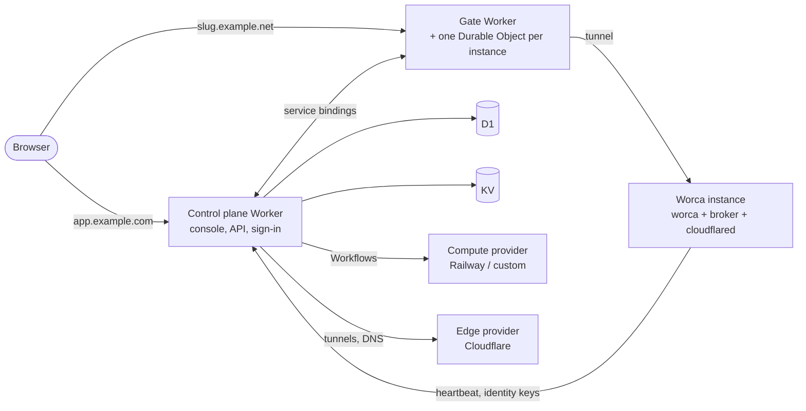

> [!NOTE]
> This project will soon move to a new organization: [github.com/worca-org](https://github.com/worca-org).

# Worca platform

Run your own hosted [Worca](https://github.com/SinishaDjukic/worca-cc): a multi-tenant management
platform where organizations sign up, create teams, and run their own Worca instances, each on its
own subdomain, managed from one console.

- **Control plane and console** on Cloudflare Workers (Hono, Better Auth, D1, KV, Workflows):
  users, organizations, teams, instances, sign-in by email code, passkey, Google, Microsoft or an
  organization's own SSO.
- **The gate**, a Worker in front of every instance: checks that the visitor's teams grant access,
  applies the browser isolation rules, and hands Worca a signed identity token. Each instance's
  status and sessions live in its own Durable Object, so revoking access or stopping an instance
  takes effect at once.
- **Compute providers** create the instances (Worca, its credential broker, cloudflared): Railway
  built in, others pluggable. **Edge providers** connect them: one Cloudflare Tunnel per instance.
- Tenant data is encrypted with application-level keys, one per org and one per user, so deleting
  an org or a user destroys its key and its data with it.



## Quick start

You need Node.js 22.19 or newer, a Cloudflare account on Workers Paid with two zones (one for the
console, one for the instances), a Railway workspace (or another compute provider) and a Resend
account.

```bash
npm create @worca/platform my-deploy
cd my-deploy
npm run setup     # D1, KV, secrets, migrations, both Workers deployed
npm run admin -- you@example.com     # the first superadmin
```

`npm run dev` runs the same deployment locally with fake providers, no accounts needed. Every
step, the token scopes and the costs are in [Deploying your own platform](docs/deploy.md).

## Before you open it to others

- **Railway's terms.** Railway's Acceptable Use Policy forbids "reselling compute resources". Sell
  Worca as a product, not vCPU and memory, and ask Railway to confirm your use in writing before
  you take customers, or use another compute provider ([Compute providers](docs/providers.md)).
- **The Public Suffix List.** Until your instance domain is on the
  [Public Suffix List](https://publicsuffix.org/submit/), browsers treat all instances as one site
  and only the gate keeps their cookies and storage apart. Request it as soon as the domain is
  registered.

## Supported Worca versions

The platform deploys the Worca instance image published by
[worca-cc](https://github.com/SinishaDjukic/worca-cc). This release supports `@worca/app` **1.9.0
or newer**; each release states its range in [CHANGELOG.md](CHANGELOG.md). What an instance is
made of and what the platform sets on it is worca-cc's
[instance contract](https://github.com/SinishaDjukic/worca-cc/blob/dev/docs/instance-contract.md):
build your own management interface on it, or run a single instance with Docker Compose.

## Packages

| Package | What it is |
| --- | --- |
| [`@worca/platform`](packages/platform) | The Workers (`createControl`, `createGate`), the console, the migrations, the providers, the `worca-platform` CLI, the portable smoke test |
| [`@worca/create-platform`](packages/create-platform) | `npm create @worca/platform`: writes and installs a new deployment |

## Documents

| Document | What it covers |
|---|---|
| [Deploying your own platform](docs/deploy.md) | Accounts, tokens, what setup does, costs, day to day, CI |
| [Compute providers](docs/providers.md) | The provider interface, lifecycle, retry rules, conformance checks, a skeleton provider |
| [Branding](docs/branding.md) | Names, logo, colours and mail of a deployment |
| [Architecture](docs/architecture.md) | Components, hosts, request and provisioning flows, the stack |
| [Identity and access](docs/identity-and-access.md) | Roles, orgs, teams, instances, sign-in methods, the instance gate |
| [Security](docs/security.md) | Domain isolation, the gate's header policy, encryption, audit, abuse |
| [Data model](docs/data-model.md) | Tables, which fields are encrypted, keys |
| [Instance lifecycle](docs/instance-lifecycle.md) | Create, heartbeat, upgrade, suspend and wake, delete |
| [Internal APIs](docs/internal-apis.md) | Between the Workers and between the platform and Worca |
| [Decisions](docs/decisions.md) | Every design decision, numbered, with the reason |
| [UI concept](docs/ui.md) | Views of the org workspace and the platform console, by role |
| [Railway](docs/railway.md) | What the Railway provider uses, plan limits, stopping and waking, compute facts |
| [Fly.io](docs/fly.md) | An evaluation of Fly.io as a compute provider |
| [Development](docs/development.md) | Working on this repo: layout, local stack, tests |
| [Releasing](docs/RELEASING.md) | Tag-driven releases of both packages |

## Versioning

- **Semver.** Major: a `worca.config.ts` change that needs editing, a renamed binding, class,
  Worker or Workflow name, a removed variable or secret, a migration that needs a manual step, a
  dropped `@worca/app` version range, a changed provider interface. Minor: new features, new
  optional config, forward-only migrations that apply on their own. Patch: fixes.
- **Migrations** are forward-only, named `NNNN_description.sql`, and never renamed or edited once
  released: wrangler records applied migrations by filename, so a rename re-runs one.
- **Security fixes** go to the latest minor only ([Security policy](SECURITY.md)).

## Contributing

See [CONTRIBUTING.md](CONTRIBUTING.md). Opening a pull request means you accept the
[DCO](DCO); everyone taking part follows the [Code of Conduct](CODE_OF_CONDUCT.md).

## License

[MIT](LICENSE). The Worca name, logo and mark are not covered by the MIT license: see
[NOTICE](NOTICE). Bundled fonts: [THIRD_PARTY_NOTICES.md](THIRD_PARTY_NOTICES.md).
